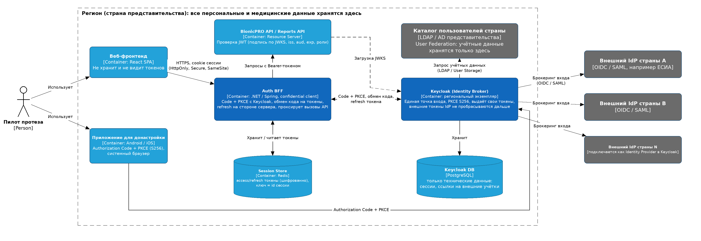
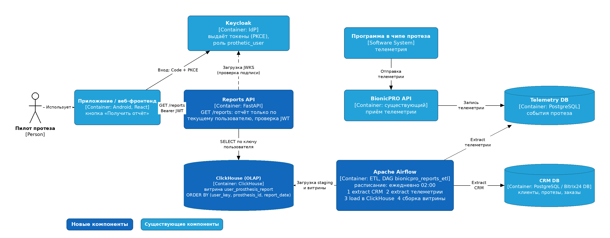

# BionicPRO — SSO / отчёты

Учебный стенд: React-фронтенд + Keycloak (SSO по OAuth 2.0), запускается через
`docker compose`.

## Спринт 9, задача 1 — усиление безопасности: Code Grant → Authorization Code + PKCE (S256)

### Что изменилось

Ранее публичный клиент `reports-frontend` использовал «чистый» Authorization
Code Grant. Теперь включён **Authorization Code Flow с PKCE и методом S256**:

- **Keycloak** (`keycloak/realm-export.json`), клиент `reports-frontend`:
  - публичный клиент (без client secret), **Standard flow — вкл.**;
  - **Implicit flow — выкл.**, **Direct access grants — выкл.** (в репозитории не
    использовались);
  - атрибут **`pkce.code.challenge.method` = `S256`** (в консоли это
    *Proof Key for Code Exchange Code Challenge Method = S256*) — Keycloak
    **отклоняет** запросы авторизации без `code_challenge`;
  - точные (без `*`) redirect URI и web origin для локальной разработки:
    redirect `http://localhost:3000/`, web origin `http://localhost:3000`.
  - Пользователи, роли и клиент `reports-api` оставлены без изменений.
- **Фронтенд** (`frontend/src/App.tsx`): в `ReactKeycloakProvider` передаётся
  `initOptions={{ pkceMethod: 'S256', checkLoginIframe: false }}`. `keycloak-js`
  сам генерирует `code_verifier`, отправляет `code_challenge` и
  `code_challenge_method=S256` в запросе авторизации и `code_verifier` в запросе
  токена. Токены хранятся **в памяти** `keycloak-js` (не в `localStorage`).

> Компромисс по хранению токенов: in-memory безопаснее `localStorage`
> (нет доступа из постороннего JS, нет утечки между вкладками), но токен
> теряется при перезагрузке страницы — повторная тихая аутентификация
> происходит через Keycloak. Полноценное серверное хранение — задача BFF
> (см. «Целевая архитектура»), в рамках этого шага не реализуется.

### Как запустить

```bash
docker compose up -d --build
```

- Фронтенд: http://localhost:3000
- Keycloak: http://localhost:8080 (админ `admin` / `admin`)
- Realm `reports-realm` импортируется автоматически (`--import-realm`).

> Примечание: изменения в `realm-export.json` применяются только при **чистой**
> БД — Keycloak с `--import-realm` пропускает импорт, если realm уже существует.
> Для переимпорта: `docker compose down`, удалить каталог
> `./postgres-keycloak-data`, затем `docker compose up -d`.

Тестовые пользователи (из realm): `user1/password123`, `admin1/admin123`,
`prothetic1/prothetic123` и др.

### Как проверить, что PKCE действительно используется

**1. Запрос авторизации БЕЗ `code_challenge` должен отклоняться** (негативный тест):

```bash
curl -s -o /dev/null -D - \
 "http://localhost:8080/realms/reports-realm/protocol/openid-connect/auth?client_id=reports-frontend&response_type=code&scope=openid&state=neg&redirect_uri=http://localhost:3000/" \
 | grep -i location
# Location: http://localhost:3000/?error=invalid_request&error_description=Missing+parameter%3A+code_challenge_method&state=neg
```

**2. Полный поток с `code_verifier`** (позитивный) и **неверный `code_verifier`**
(негативный): запрос токена с правильным verifier возвращает `access_token`
(HTTP 200), с неверным — `HTTP 400 invalid_grant: PKCE verification failed`.

**3. Через браузер:** открыть http://localhost:3000, нажать *Login*. В DevTools →
Network у запроса `.../openid-connect/auth` в query будут `code_challenge` и
`code_challenge_method=S256`, а у POST `.../openid-connect/token` в теле —
`code_verifier`.

### Целевая архитектура (куда это развивается)

Диаграмма (C4, container-level): [`Task1/bionicpro-auth-c4.png`](Task1/bionicpro-auth-c4.png).



- **Keycloak как identity broker, по одному на страну** — локальное хранение
  персональных данных и соответствие требованиям резидентства.
- **User federation к локальному LDAP/AD** — пользователи остаются в
  корпоративном каталоге, Keycloak федерирует их (в стенде есть пример
  `ldap/config.ldif`).
- **Внешние IdP как Identity Providers** с опцией **«Store Tokens» выключена** —
  Keycloak не хранит токены внешних провайдеров, только транслирует вход.
- **BFF (Backend-for-Frontend)** хранит access/refresh токены на сервере, а
  браузеру отдаёт только **HttpOnly-cookie сессии** — токены не доступны из JS.
  *(BFF в рамках этой задачи не реализуется — это следующий шаг.)*

---

## Спринт 9, задача 2 — сервис отчётов (ETL → OLAP → API → фронтенд)

Пилот протеза запрашивает отчёт о **своём** протезе. Отчёт **заранее
вычисляется** ETL-процессом (Airflow) и складывается в OLAP-витрину
(ClickHouse); бэкенд `reports-api` при запросе делает только простой
`SELECT` по ключу — без тяжёлых вычислений в рантайме.

### Архитектура потока отчётов



Диаграмма (C4, container-level): [`Task2/bionicpro-reports-c4.png`](Task2/bionicpro-reports-c4.png),
редактируемый исходник — [`docs/bionicpro-reports-c4.drawio`](docs/bionicpro-reports-c4.drawio).

```
CRM DB ─┐
         ├─► Airflow (ETL, DAG bionicpro_reports_etl) ─► ClickHouse (витрина) ─► Reports API ─► Frontend
Telem DB ┘                                                                          ▲
                                                           Keycloak ── выдаёт JWT ──┘ (API проверяет подпись через JWKS)
```

Компоненты (всё поднимается одним `docker compose up`):

| Сервис | Назначение | Порт (host) |
|---|---|---|
| `crm_db` | CRM (стенд-ин Bitrix24): клиенты, протезы | 5434 |
| `telemetry_db` | телеметрия протезов (события) | 5435 |
| `clickhouse` | OLAP-витрина `marts.user_prosthesis_report` | 8123 / 9000 |
| `airflow-webserver` / `airflow-scheduler` | ETL (LocalExecutor) | 8081 (UI) |
| `reports-api` | FastAPI, выдаёт отчёт текущему пользователю | 8000 |
| `keycloak`, `frontend` | из задачи 1 | 8080 / 3000 |

### Как запустить

```bash
cp .env.example .env            # dev-only креды
docker compose up -d --build    # ~10 контейнеров
```

> Как и в задаче 1: изменения `realm-export.json` (здесь — audience-маппер и
> dev-клиент `reports-test`) применяются только на **чистой** БД Keycloak.
> Для переимпорта: `docker compose down`, удалить `./postgres-keycloak-data`,
> затем `docker compose up -d`.
>
> Примечание: при первом `up` Airflow-init (миграции БД) выполняется заметное
> время; сервисы `keycloak`, `reports-api`, `airflow-scheduler` могут остаться
> в состоянии *Created* — повторный `docker compose up -d` поднимет их, когда
> зависимости станут healthy.

### ETL: расписание и ручной запуск

DAG `bionicpro_reports_etl`: `schedule="0 2 * * *"` (ежедневно в 02:00),
`catchup=False`, retries=2. Задачи: `create_schema → [extract_crm,
extract_telemetry] → load_staging → build_mart`. Идемпотентность — полная
перезагрузка staging и пересборка витрины при каждом прогоне (повторный
запуск не плодит строки).

Разовый запуск для демо (UI: http://localhost:8081, `admin`/`admin`):

```bash
docker compose exec airflow-scheduler airflow dags unpause bionicpro_reports_etl
docker compose exec airflow-scheduler airflow dags trigger bionicpro_reports_etl
# либо синхронно, с выводом результата:
docker compose exec airflow-scheduler airflow dags test bionicpro_reports_etl
```

Проверить витрину:

```bash
docker compose exec clickhouse clickhouse-client --password clickhouse_password \
  -q "SELECT user_email, prosthesis_id, report_date, events_count, p95_response_ms \
      FROM marts.user_prosthesis_report FINAL ORDER BY user_email LIMIT 20"
```

### Структура витрины и почему это быстро

`marts.user_prosthesis_report` — одна строка на `(user_email, prosthesis_id,
report_date)`:

- движок **`ReplacingMergeTree(_loaded_at)`**, `ORDER BY (user_email,
  prosthesis_id, report_date)`, `PARTITION BY toYYYYMM(report_date)`;
- метрики за день: `events_count`, `avg/max/p95_response_ms`, `errors_count`,
  `avg_battery_pct`, `movements_count`, `first/last_event_ts`.

**Почему быстро:** всё агрегирование (join телеметрии с CRM, перцентили)
выполняет ETL заранее. API делает `SELECT ... WHERE user_email = {email}` —
это совпадает с первичным ключом сортировки витрины, поэтому чтение идёт по
префиксу индекса без сканирования и без join в рантайме. `FINAL` схлопывает
возможные дубликаты `ReplacingMergeTree`.

### Контракт API

- `GET /health` — без авторизации, `{"status":"ok"}`.
- `GET /reports` — требует Bearer-токен. Параметры (все необязательные):
  `from`, `to` (`YYYY-MM-DD`, фильтр по `report_date`), `format=json|csv`.
  Возвращает отчёт **только текущего пользователя**: `user_email`, инфо о
  пользователе, `rows[]` по дням/протезам и `summary`. `?format=csv` — тот же
  набор строк в CSV. OpenAPI: http://localhost:8000/docs.

### Правила доступа

- Токен проверяется **офлайн**: подпись через JWKS realm (RS256), `iss`,
  `exp`, `aud` должен содержать **`reports-api`** (добавлен audience-маппер в
  realm).
- Требуется realm-роль **`prothetic_user`** — иначе **403**; отсутствующий или
  недействительный токен — **401**.
- Личность берётся **только** из claim `email` в токене и используется как ключ
  витрины. Параметр `user_id`/`email` в запросе, не равный личности из токена,
  → **403** (клиент не может подменить пользователя).
- CORS разрешён только для origin фронтенда (`http://localhost:3000`).
- Запросы к ClickHouse **параметризованы** (без конкатенации строк).

### Тестовые пользователи

Отчёт видят пользователи с ролью `prothetic_user`, чьи email совпадают с
клиентами CRM: `prothetic1@example.com`, `prothetic2@example.com`,
`prothetic3@example.com` (пароль `prothetic123`). Пользователь `user1`
(роль `user`) получает **403**.

Получить токен для проверки (dev-клиент `reports-test` с Direct Access Grants;
боевой клиент `reports-frontend` остаётся без этой возможности):

```bash
curl -s -d client_id=reports-test -d grant_type=password \
  -d username=prothetic1 -d password=prothetic123 \
  http://localhost:8080/realms/reports-realm/protocol/openid-connect/token
```

### Тесты

```bash
docker compose run --rm --no-deps reports-api python -m pytest -q
```

Покрывают: нет токена → 401, роль `user` → 403, `user1` не видит данные
`user2`, happy-path отдаёт только свои строки, CSV. JWKS и ClickHouse
замоканы.

> Оговорка про хранение токена (как в задаче 1): в целевой архитектуре токены
> держит **BFF**, а браузер получает только session-cookie. В рамках этого шага
> SPA вызывает `reports-api` напрямую со своим Keycloak-токеном.
